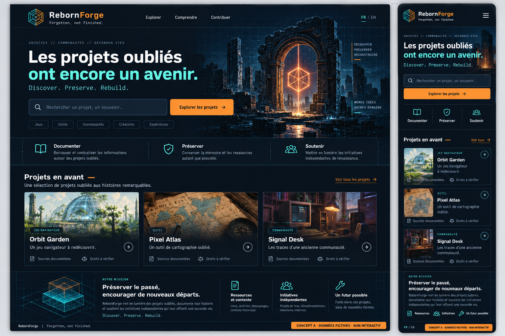
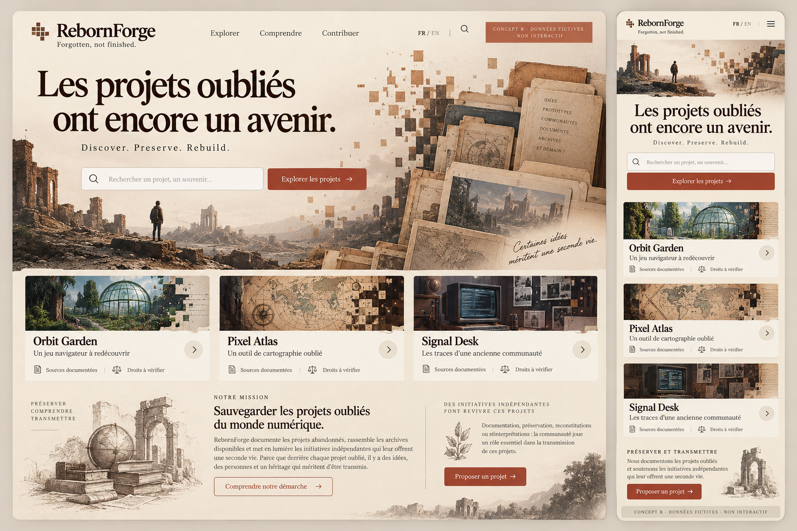
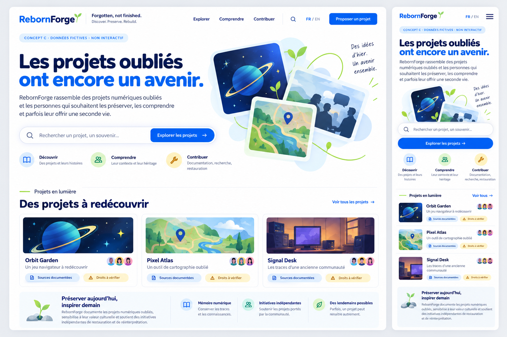

[Français](#français) · [English](#english)

## Français

# Phase 3 — Trois directions graphiques

**19 octobre 2026 · Proposed.** Maquettes visuelles statiques d’accueil, avec desktop à gauche et adaptation smartphone à droite. Aucun concept, logo, palette, police ou technologie n’est adopté.

## Consulter les planches

### A — Digital Forge

[Ouvrir la planche A](assets/concept-a-digital-forge.png). Bleu nuit, turquoise, orange ; grille technique, symbole géométrique et contraste fort. L’ensemble met l’action et les métadonnées en avant.

### B — Digital Heritage

[Ouvrir la planche B](assets/concept-b-digital-heritage.png). Papier clair, encre brune, terre cuite ; grand titre éditorial, récit visuel et références d’archives. L’ensemble exprime le patrimoine avant la technique.

### C — Modern Community

[Ouvrir la planche C](assets/concept-c-modern-community.png). Fond clair, bleu vif, touches vertes ; sans-serif arrondie, cartes conviviales, commandes simples et espace généreux. L’ensemble favorise l’entrée des non-développeurs.

## Arbitrer

Lire la [comparaison détaillée](COMPARISON.md), la [revue visuelle et les limites](VISUAL_REVIEW.md) puis le [texte français/anglais des maquettes](COPY_FR_EN.md).

**Recommandation : B comme direction patrimoniale, en reprenant la simplicité de recherche et de navigation de C.** Ce mélange reste une proposition : aucune direction n’est officialisée sans choix explicite. A reste une option solide si l’identité technique doit primer.

Le fondateur peut choisir A, B, C, une combinaison précisément décrite, demander des corrections ou refuser les trois.

## Nature des livrables

Images PNG de 1536×1024 générées pour explorer une direction artistique, pas captures d’une application. Projets Orbit Garden, Pixel Atlas et Signal Desk, visuels et avatars sont fictifs ; aucune source historique réelle n’est revendiquée. Les illustrations ne sont pas des captures de logiciels oubliés. Les commandes sont non interactives.

Les interfaces sont en français ; leur traduction anglaise est fournie dans le document de textes. Une version graphique anglaise détaillée suivra la direction validée, sans promettre une localisation déjà testée.

La PR de phase 3 dépend de la branche UX : PR #4 encore ouverte au démarrage de ce travail. Aucune fusion n’est exécutée. Après validation d’une direction et autorisation distincte de phase 4 : maquettes détaillées, pas prototype. La technologie de prototypage sera proposée et validée en phase 5.

---

## English

# Phase 3 — Three visual directions

**19 October 2026 · Proposed.** Static homepage mockups, desktop left and smartphone adaptation right. No concept, logo, palette, font or technology adopted.

## View the boards

### A — Digital Forge

[Open board A](assets/concept-a-digital-forge.png). Midnight, turquoise and orange; technical grid, geometric symbol and strong contrast. Emphasizes action and metadata.

### B — Digital Heritage

[Open board B](assets/concept-b-digital-heritage.png). Light paper, brown ink and terracotta; oversized editorial headline, visual narrative and archive references. Puts heritage before technology.

### C — Modern Community

[Open board C](assets/concept-c-modern-community.png). Bright background, vivid blue and green details; rounded sans-serif, friendly cards, simple controls and generous space. Welcomes non-developers.

## Decide

Read the [detailed comparison](COMPARISON.md), [visual review/limits](VISUAL_REVIEW.md) and [French/English mockup copy](COPY_FR_EN.md).

**Recommendation: B's heritage identity with C's straightforward search and navigation.** This combination remains a proposal; no direction is official without explicit selection. A remains strong if technical identity should lead.

The founder can select A/B/C, specify a combination, request revisions or reject all three.

## Deliverable nature

1536×1024 PNGs generated for art-direction exploration, not application screenshots. Orbit Garden, Pixel Atlas, Signal Desk, illustrations and avatars are fictional; no historical evidence claimed. Illustrations are not screenshots of forgotten software. Controls are non-interactive.

Interface mockups are French; English translations are supplied in the copy document. Detailed English visual layouts follow the approved direction; localization is not claimed tested.

Phase 3 depends on the UX branch: PR #4 remained open when work began. No merge performed. After direction approval and separate phase 4 authorization: detailed mockups, not a prototype. Prototype technology will be proposed and approved in phase 5.
