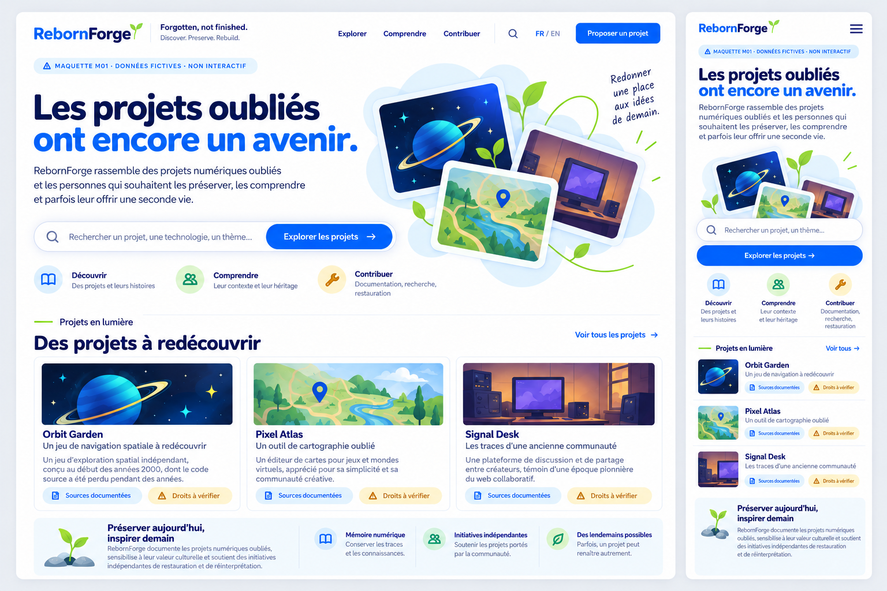

[Français](#français) · [English](#english)

## Français

# Phase 4 — Maquettes détaillées Modern Community

**19 octobre 2026 · À valider.** Direction C retenue ; préparation de phase 4 autorisée. Les maquettes restent proposées, pas approuvées. Images statiques, données fictives, aucune fonctionnalité opérationnelle.

## Ouvrir les planches

Chaque lien ouvre un PNG directement sur GitHub. Les pages principales présentent desktop et smartphone ; les planches M11/M12 rassemblent les variantes et états.

| ID | Planche | Formats |
| --- | --- | --- |
| M01 | [Accueil](assets/m01-accueil.png) | Desktop + smartphone |
| M02 | [Catalogue](assets/m02-catalogue.png) | Desktop + smartphone |
| M03 | [Recherche et filtres](assets/m03-recherche-filtres.png) | Desktop + smartphone |
| M04 | [Fiche historique](assets/m04-historique.png) | Desktop + smartphone |
| M05 | [Initiative de renaissance](assets/m05-renaissance.png) | Desktop + smartphone |
| M06 | [Proposer un projet](assets/m06-proposer.png) | Desktop + smartphone |
| M07 | [Connexion et profil privé](assets/m07-connexion-profil.png) | Desktop + smartphone |
| M08 | [Tableau de bord](assets/m08-tableau-de-bord.png) | Desktop + smartphone |
| M09 | [Interface de contribution](assets/m09-contribution.png) | Desktop + smartphone |
| M10 | [Modération](assets/m10-moderation.png) | Desktop + smartphone |
| M11 | [États de navigation](assets/m11-etats-navigation.png) | Desktop + smartphone |
| M12 | [États de formulaire et revue](assets/m12-etats-formulaires.png) | Desktop + smartphone |

Exemple d’entrée dans la série :

## Spécifications et revue

- [Pages, hiérarchie et navigation](PAGE_SPECIFICATIONS.md).
- [États, formulaires et permissions](STATES_AND_INTERACTIONS.md).
- [Textes français et anglais](COPY_FR_EN.md).
- [Revue visuelle et limites de vérification](REVIEW.md).
- [Autorisation de phase](../../decisions/RF-012-phase-4-authorization.md) et [validation graphique attendue](../../decisions/RF-013-detailed-mockup-review.md).

Le clair, le bleu, la simplicité des cartes et les arrondis viennent de C. Pas de profils publics enrichis, votes, téléchargements ou commentaires communautaires. Les échanges montrés dans M09 sont privés et limités à une contribution.

## Décision attendue

Valider ou demander des corrections sur les pages, versions mobiles et états. L’acceptation d’une seule planche ne vaut pas validation du lot. Les textes sources de ce dossier priment sur toute approximation typographique de génération.

Les interfaces graphiques sont en français. L’anglais est fourni dans les spécifications et le document de textes ; les compositions anglaises complètes ne sont pas encore vérifiées visuellement. Aucun test de compréhension n’est revendiqué.

## Dépendances et suite

PR #4 UX et PR #5 concepts étaient ouvertes au démarrage ; la présente PR cible la branche de #5. Aucune fusion de ces branches n’est exécutée ici. Après leurs fusions autorisées, réorienter cette PR et vérifier le diff.

Après validation des maquettes seulement : proposer technologie, périmètre et conditions du prototype de phase 5, puis obtenir autorisation avant exécution. Ni prototype interactif, ni application, ni design system définitif dans ce lot.

---

## English

# Phase 4 — Detailed Modern Community mockups

**19 October 2026 · Awaiting approval.** C selected and phase 4 preparation authorized. Mockups remain proposed, not approved. Static images, fictional data, no operational features.

## Open boards

Each link opens a PNG directly on GitHub. Main pages show desktop/smartphone; M11/M12 collect variants and states.

| ID | Board | Formats |
| --- | --- | --- |
| M01 | [Home](assets/m01-accueil.png) | Desktop + smartphone |
| M02 | [Catalogue](assets/m02-catalogue.png) | Desktop + smartphone |
| M03 | [Search and filters](assets/m03-recherche-filtres.png) | Desktop + smartphone |
| M04 | [Historical record](assets/m04-historique.png) | Desktop + smartphone |
| M05 | [Revival initiative](assets/m05-renaissance.png) | Desktop + smartphone |
| M06 | [Project submission](assets/m06-proposer.png) | Desktop + smartphone |
| M07 | [Sign-in and private profile](assets/m07-connexion-profil.png) | Desktop + smartphone |
| M08 | [Dashboard](assets/m08-tableau-de-bord.png) | Desktop + smartphone |
| M09 | [Contribution workspace](assets/m09-contribution.png) | Desktop + smartphone |
| M10 | [Moderation](assets/m10-moderation.png) | Desktop + smartphone |
| M11 | [Navigation states](assets/m11-etats-navigation.png) | Desktop + smartphone |
| M12 | [Form and review states](assets/m12-etats-formulaires.png) | Desktop + smartphone |

## Specifications and review

- [Pages, hierarchy and navigation](PAGE_SPECIFICATIONS.md).
- [States, forms and permissions](STATES_AND_INTERACTIONS.md).
- [French/English copy](COPY_FR_EN.md).
- [Visual review and verification limits](REVIEW.md).
- [Phase authorization](../../decisions/RF-012-phase-4-authorization.md) and [pending graphical review](../../decisions/RF-013-detailed-mockup-review.md).

Light surfaces, blue, simple cards and rounding follow C. No enriched public profiles, votes, downloads or community comments. M09 exchanges are private and scoped to a submission.

## Requested decision

Accept or request changes to pages, mobile versions and states. One accepted board does not approve the full set. Source copy overrides incidental generated lettering.

Graphical interfaces are French; English is provided in specifications and the copy document. Full English layouts have not been visually verified. No comprehension testing claimed.

## Dependencies and next step

PR #4 UX and PR #5 concepts remained open at start; this PR targets #5's branch. No merges performed. After authorized prerequisite merges, retarget and check the diff.

Only after mockup approval: propose phase 5 prototype technology/scope/conditions and obtain authorization before execution. No interactive prototype, application or final design system in this package.
